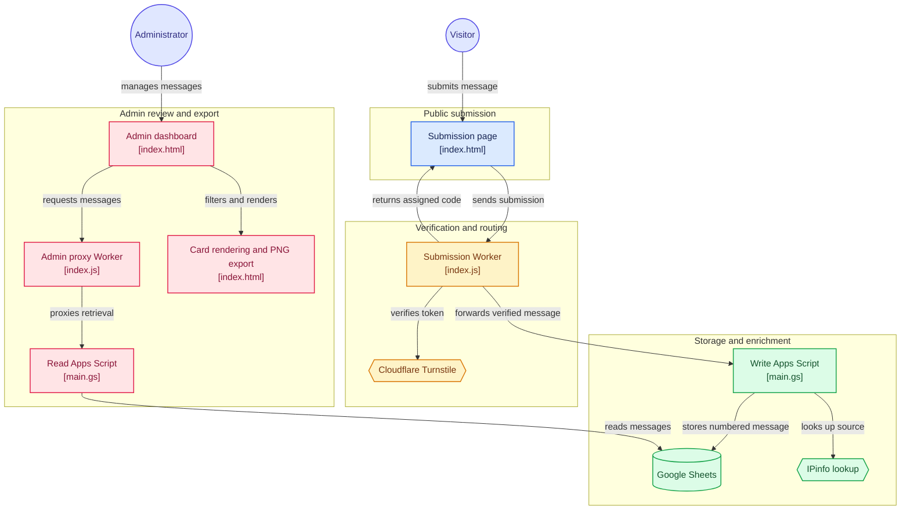

# 匿名問答系統 (AQA System) 📬

> 一套零成本、可自架的開源匿名問答系統！採用 Serverless（無伺服器）架構，基於 Cloudflare Workers + Google Sheets + Google Apps Script 打造。完全免費、資料 100% 自主掌控！


相信各位在 Instagram 或其他社群上，常常會看到那種「匿名問答箱」（例如 NGL.link 或 Marshmallow-qa 等等） ：丟一條連結給粉絲，大家匿名發送問題或想說的話，你再挑幾則貼到限時動態上回答。

用起來很方便，沒錯，我自己也用過。但資料都在第三方手上，他們怎麼存、怎麼用、會不會外洩，你完全無法掌控。

於是我就想：這種東西為什麼不能自己做？

而且我要的是——

- 完全免費（不要為了解鎖什麼特殊留言功能而付月費）
- 不用自己架伺服器（我不是伺服器管理員的，雖然管理員聽起來很酷）
- 資料 100% 自己掌控
- 能一鍵把留言變成好看的圖卡，直接貼 IG 限動
(且包含市面上常見的匿名問答系統有的功能)

這就是這個專案的起點：一個我自己做的、開源、可自主架設的匿名問答系統。

[](/LICENSE)
[](https://www.aiixi.cc/posts/aqa-system/)

## 專案簡介


這是一款完全開源且可自主架設的匿名問答系統，旨在成為Instagram或其他社交平台上，常出現的匿名問答服務的替代方案。

讓你擺脫第三方平台對資料的掌控與隱私疑慮，利用 Cloudflare Worker 與 Google Sheets 打造無伺服器架構——不僅資料 100% 由自己掌控，還整合了 Cloudflare Turnstile 防刷驗證與 IP/裝置紀錄，提供更安全、免費且高度自主的匿名留言體驗。

## 特色與功能

- 完全無須架設自己的伺服器
- Cloudflare Turnstile 驗證防機器人
- 收集 IP、User-Agent並透過 ipinfo.io API 解析IP所在地
- 帶有留言查看面板（後台），可以直接查看留言並生成留言圖片，貼上 Instagram 限時動態（舉例）
- 留言資料自己掌控
- 每一則留言會產生一個辨識碼，方便粉絲辨識自己的留言
- 可以在前端網頁的URL後面加上`?tag=`標籤參數，方便辨識留言的來源
- 本專案使用 [MIT License](LICENSE)，你完全可以自己修改程式碼

## 如何讓別人透過這個系統發送留言？

和一般的匿名問答系統一樣，直接將匿名問答系統網頁的網址傳送給粉絲、朋友即可。

你也可以在網址後面加上`?tag=吧拉吧拉`參數，這個Tag的值會一併記錄到使用者發送的留言中，並且只有資料庫持有者（你）會知道，可以用來分流、辨識留言來源。

系統會配發給發送留言者一個獨一無二的流水號（例如：`AQA-9487`），這組流水號也會記錄到使用者發送的留言中，並且會顯示在留言面板（後台）網頁中生成的留言卡片顯示，這樣一來就可以讓發送留言者在你的Instagram限動上（舉例而已）辨識自己發送的留言。


## 你（留言資料庫持有者）如何查看留言查看面板（後台）

我也有設計一個**留言查看面板（也可以稱後台）**，它會透過Google Apps Script讀取Google Sheet，然後網頁去讀取Apps Script，渲染成圖卡，可以方便查看留言，甚至一鍵生成留言圖卡，然後貼到Instagram上傳（舉例）。


詳情請看[留言查看面板(簡稱後台)架設教學](#留言查看面板簡稱後台架設教學)

## 開始架設前的準備

- Google 帳號：建立 Google Sheets 與部署 Google Apps Script。免費。
- Cloudflare 帳號：部署 Worker 與建立 Turnstile Widget。免費。
- IPinfo Lite API Token：用於查詢 IP 的國家／地區與 ASN。免費版僅可查詢來源IP國家/地區、ASN
- 靜態網頁空間：可使用 GitHub Pages、Cloudflare Pages 或任何可託管 HTML 的免費穩定服務。免費。

## 發送留言的系統架設教學

### 完整原理

> 下方流程圖是使用AI進行摘要，因為我能力不足，我不會做流程圖，非常抱歉！




### Google Sheets

1. 去 [Google Sheets](https://docs.google.com/spreadsheets/) 建立一個空白試算表
2. 在**第一欄**貼入：
    ```
    接收時間 （台北時間）	留言	來源IP	Tags	來源國家/地區	AS_Name	User-Agent	唯一辨識碼
    ```
3. 記下試算表URL和試算表名稱
    

#### 2. 寫入用 Google Apps Script

1. 開啟 [Google Apps Script](https://script.google.com/home/) 建立新專案。
2. 貼入專案檔 `gas/main.gs` 的內容。
3. 於 **專案設定 ➔ 指令碼屬性** 新增：
* `IPINFO_TOKEN`：你的 ipinfo.io API Token
* `SHEET_NAME`：試算表名稱
* `SHEET_URL`：試算表 URL
* `WRITE_KEY`：自訂一串隨機金鑰（長度建議 32 字元以上）


4. 部署為網頁應用程式（存取權限設為「所有人」），記下部署 URL。

#### 3. 前台 Cloudflare Worker

1. 於 Cloudflare 建立 Worker。
2. 貼入專案檔 `worker/index.js` 的內容。
3. 註冊 **Cloudflare Turnstile** 小工具，取得 `Site Key` 與 `Secret Key`。
4. 於 Worker 的 **設定 ➔ Runtime variables** 設定環境變數：
* `TURNSTILE_SECRET_KEY`：Turnstile Secret Key
* `APPS_SCRIPT_URL`：寫入用 GAS 部署 URL
* `APPS_SCRIPT_WRITE_KEY`：與 GAS 一致的 `WRITE_KEY`


5. 部署並記下 Worker URL。

#### 4. 前台 HTML

1. 編輯 `frontend/index.html`。
2. 替換以下變數：
* `YOUR_ICON_URL_HERE`：圖示 URL
* `YOUR_WORKER_URL_HERE`：前台 Worker URL
* `YOUR_TURNSTILE_SITE_KEY_HERE`：Turnstile Site Key


3. 將 HTML 部署至靜態託管平台。

---

### 第二階段：留言查看面板（後台）

#### 1. 後台 Google Apps Script

1. 建立新的 Google Apps Script 專案，貼入 `admin_panel_gas/main.gs`。
2. 於指令碼屬性設定：
* `SHEET_NAME`：試算表名稱
* `SHEET_URL`：試算表 URL
* `READ_KEY`：自訂一串後台讀取隨機金鑰
* `TIMEZONE`：預設 `Asia/Taipei`
* `IPINFO_TOKEN`：（可選）資料修復用


3. 部署為網頁應用程式（權限設為「所有人」），記下部署 URL。

#### 2. 後台 Cloudflare Worker 代理

1. 建立新的 Worker（如 `aqa-admin-proxy`），貼入 `admin_panel_worker/index.js`。
2. 於環境變數設定：
* `APPS_SCRIPT_URL`：後台 GAS 部署 URL
* `ADMIN_PASSWORD`：自訂後台登入密碼


3. 部署並記下 Worker URL。

#### 3. 後台 HTML

1. 編輯 `admin_panel/index.html`。
2. 替換以下變數：
* `WORKER_URL`：後台 Worker URL
* `YOUR_CARD_IMAGE_URL_HERE`：卡片背景圖（預設 `bg.jpg`）


3. 將 HTML 部署至靜態託管平台。

---

## 🔒 安全性設計

* **Turnstile 防機器人**：有效阻止自動化腳本洗版與垃圾留言。
* **雙向金鑰驗證**：前台與後台 GAS 分別透過 `WRITE_KEY` 與 `READ_KEY` 保護，防止繞過 Worker 直接存取 API。
* **無痕憑證管理**：管理者密碼僅暫存於 `sessionStorage`，視窗關閉即自動抹除，防範 XSS 竊取風險。
* **Lock Service 互斥鎖**：確保多人同時留言時，流水號不重覆、不撞號。
* **排版保護機制**：動態字數計算與字級縮放，避免超長字串破壞卡片視覺佈局。

---

## ❓ 常見問題 (FAQ)

---

## 📄 配額與定價文件參考

* [Google Apps Script 服務每日配額文件](https://developers.google.com/apps-script/guides/services/quotas?hl=zh-tw)
* [Cloudflare Workers 方案定價文件](https://www.cloudflare.com/zh-tw/plans/developer-platform-pricing/)

---

## 📜 License

本專案採用 [MIT License](https://www.google.com/search?q=LICENSE) 條款開源，歡迎自由使用、修改與二次開發。
