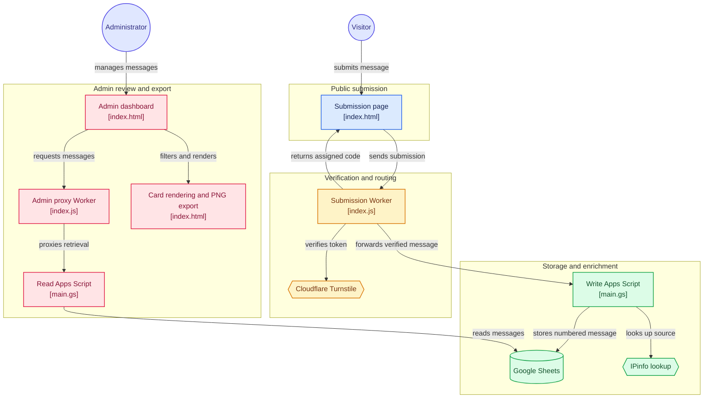

# 匿名問答系統 (AQA System) 📬

> 一套零成本、可自架的開源匿名問答系統！採用 Serverless（無伺服器）架構，基於 Cloudflare Workers + Google Sheets + Google Apps Script 打造。完全免費、資料 100% 自主掌控！


相信各位在 Instagram 或其他社群上，常常會看到那種「匿名問答箱」（例如 NGL.link 或 Marshmallow-qa 等等） ：丟一條連結給粉絲，大家匿名發送問題或想說的話，你再挑幾則貼到限時動態上回答。

用起來很方便，沒錯，我自己也用過。但資料都在第三方手上，他們怎麼存、怎麼用、會不會外洩，你完全無法掌控。

於是我就想：這種東西為什麼不能自己做？

而且我要的是——

- 完全免費（不要為了解鎖什麼特殊留言功能而付月費）
- 不用自己架伺服器（我不是伺服器管理員的，雖然管理員聽起來很酷）
- 資料 100% 自己掌控
- 能一鍵把留言變成好看的圖卡，直接貼 IG 限動
(且包含市面上常見的匿名問答系統有的功能)

這就是這個專案的起點：一個我自己做的、開源、可自主架設的匿名問答系統。

[](/LICENSE)
[](https://www.aiixi.cc/posts/aqa-system/)

> [!IMPORTANT]
> 這裡有最新、最完整的架設教學文章：[https://www.aiixi.cc/posts/aqa-system/](https://www.aiixi.cc/posts/aqa-system/)


---

## 🌟 專案特色

- **完全免費與 Serverless 架構**：靠 Cloudflare Workers 與 Google Sheets + Apps Script 即可運行，免架設伺服器、無需輸入信用卡資訊。
- **人機驗證與安全防護**：整合 **Cloudflare Turnstile** 驗證防機器人，搭配雙向 `WRITE_KEY` / `READ_KEY` 金鑰防護與 Cloudflare Worker 後台代理。
- **無痕資安設計**：後台密碼僅儲存於 `sessionStorage`，關閉分頁即自動銷毀，避免密碼明文存於 `localStorage` 之資安風險。
- **來源解析**：自動收集來源 IP 與 User-Agent，並整合 `ipinfo.io` API 解析來源國家與 ASN。
- **動態字級排版 (Dynamic Font Size)**：卡片自動根據留言字數計算最佳字體大小與行高，短留言醒目、長留言自動收縮防爆框。
- **專屬流水號與來源 Tag**：每則留言皆配發唯一識別碼（如 `AQA-9487`），網址支援 `?tag=` 參數方便管道分流與記錄。
- **一鍵生成 IG 限動圖卡**：內建篩選後台，可輕鬆過濾留言，一鍵匯出無按鈕干擾的乾淨 PNG 圖卡。

---

## 📸 畫面預覽

| 前台公開留言頁面 | 手機版頁面 |
| :---: | :---: |
|  |  |

| 後台留言管理面板 | 留言來源與裝置資訊 | 密碼保護 |
| :---: | :---: | :---: |
|  |  | 
---

## ⚙️ 系統架構

整個架構分為兩條 Serverless 路徑：

```text
[公開留言路徑]
使用者 ➔ 前台網頁 ➔ Cloudflare Worker (驗證 Turnstile) ➔ Google Apps Script (查 IP/配發號碼) ➔ Google Sheets

[後台管理路徑]
管理者 ➔ 後台網頁 (密碼登入) ➔ Cloudflare Worker 代理驗證 ➔ 後台 Google Apps Script ➔ Google Sheets ➔ 渲染卡片 (動態字級) ➔ 匯出 PNG
```

### 架構圖



## 架設前的準備
所有服務皆可免費使用，且**無需輸入信用卡**：

* **Google 帳號**：建立 Google Sheets 試算表與部署 Apps Script。
* **Cloudflare 帳號**：部署 Workers 與設定 Turnstile Widget。
* **IPinfo Lite API Token**：註冊 [ipinfo.io/lite](https://ipinfo.io/lite) 取得免費 Token。
* **靜態網頁託管**：GitHub Pages、Cloudflare Pages 或任何靜態託管空間。

---

## 🚀 架設教學

### 第一階段：公開留言系統

#### 1. Google Sheets 試算表

1. 至 [Google Sheets](https://docs.google.com/spreadsheets/) 建立空白試算表。
2. 第一列設定表頭：
```text
接收時間 （台北時間）   留言    來源IP  Tags    來源國家/地區   AS_Name User-Agent  唯一辨識碼

```


3. 記下試算表的 **URL** 與 **頁籤名稱**。

#### 2. 寫入用 Google Apps Script

1. 開啟 [Google Apps Script](https://script.google.com/home/) 建立新專案。
2. 貼入專案檔 `gas/main.gs` 的內容。
3. 於 **專案設定 ➔ 指令碼屬性** 新增：
* `IPINFO_TOKEN`：你的 ipinfo.io API Token
* `SHEET_NAME`：試算表名稱
* `SHEET_URL`：試算表 URL
* `WRITE_KEY`：自訂一串隨機金鑰（長度建議 32 字元以上）


4. 部署為網頁應用程式（存取權限設為「所有人」），記下部署 URL。

#### 3. 前台 Cloudflare Worker

1. 於 Cloudflare 建立 Worker。
2. 貼入專案檔 `worker/index.js` 的內容。
3. 註冊 **Cloudflare Turnstile** 小工具，取得 `Site Key` 與 `Secret Key`。
4. 於 Worker 的 **設定 ➔ Runtime variables** 設定環境變數：
* `TURNSTILE_SECRET_KEY`：Turnstile Secret Key
* `APPS_SCRIPT_URL`：寫入用 GAS 部署 URL
* `APPS_SCRIPT_WRITE_KEY`：與 GAS 一致的 `WRITE_KEY`


5. 部署並記下 Worker URL。

#### 4. 前台 HTML

1. 編輯 `frontend/index.html`。
2. 替換以下變數：
* `YOUR_ICON_URL_HERE`：圖示 URL
* `YOUR_WORKER_URL_HERE`：前台 Worker URL
* `YOUR_TURNSTILE_SITE_KEY_HERE`：Turnstile Site Key


3. 將 HTML 部署至靜態託管平台。

---

### 第二階段：留言查看面板（後台）

#### 1. 後台 Google Apps Script

1. 建立新的 Google Apps Script 專案，貼入 `admin_panel_gas/main.gs`。
2. 於指令碼屬性設定：
* `SHEET_NAME`：試算表名稱
* `SHEET_URL`：試算表 URL
* `READ_KEY`：自訂一串後台讀取隨機金鑰
* `TIMEZONE`：預設 `Asia/Taipei`
* `IPINFO_TOKEN`：（可選）資料修復用


3. 部署為網頁應用程式（權限設為「所有人」），記下部署 URL。

#### 2. 後台 Cloudflare Worker 代理

1. 建立新的 Worker（如 `aqa-admin-proxy`），貼入 `admin_panel_worker/index.js`。
2. 於環境變數設定：
* `APPS_SCRIPT_URL`：後台 GAS 部署 URL
* `ADMIN_PASSWORD`：自訂後台登入密碼


3. 部署並記下 Worker URL。

#### 3. 後台 HTML

1. 編輯 `admin_panel/index.html`。
2. 替換以下變數：
* `WORKER_URL`：後台 Worker URL
* `YOUR_CARD_IMAGE_URL_HERE`：卡片背景圖（預設 `bg.jpg`）


3. 將 HTML 部署至靜態託管平台。

---

## 🔒 安全性設計

* **Turnstile 防機器人**：有效阻止自動化腳本洗版與垃圾留言。
* **雙向金鑰驗證**：前台與後台 GAS 分別透過 `WRITE_KEY` 與 `READ_KEY` 保護，防止繞過 Worker 直接存取 API。
* **無痕憑證管理**：管理者密碼僅暫存於 `sessionStorage`，視窗關閉即自動抹除，防範 XSS 竊取風險。
* **Lock Service 互斥鎖**：確保多人同時留言時，流水號不重覆、不撞號。
* **排版保護機制**：動態字數計算與字級縮放，避免超長字串破壞卡片視覺佈局。

---

## ❓ 常見問題 (FAQ)

---

## 📄 配額與定價文件參考

* [Google Apps Script 服務每日配額文件](https://developers.google.com/apps-script/guides/services/quotas?hl=zh-tw)
* [Cloudflare Workers 方案定價文件](https://www.cloudflare.com/zh-tw/plans/developer-platform-pricing/)

---

## 📜 License

本專案採用 [MIT License](https://www.google.com/search?q=LICENSE) 條款開源，歡迎自由使用、修改與二次開發。
